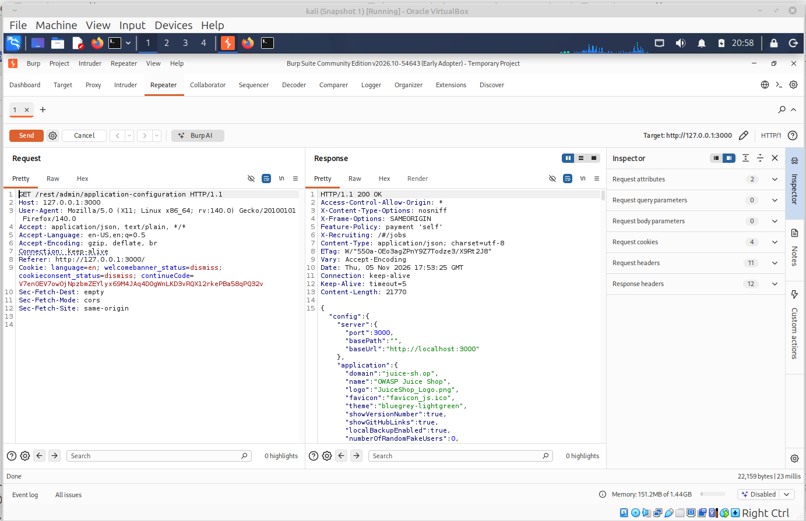

[На главную](../README.md)

# Поиск уязвимостей в Juice Shop

**Инструменты:** Kali Linux, Firefox, Burp Suite, OWASP Juice Shop (v19.2.1).
**Настройка:** Трафик из Firefox направлен через прокси Burp Suite (127.0.0.1:8080), сертификат CA установлен.

## 1. Уязвимость: Обход аутентификации (Broken Authentication / Admin Section)
**Описание:** Доступ к панели администратора без авторизации.
**Эксплуатация:**
1. В Burp Suite (вкладка **Proxy -> HTTP history**) найти запрос `GET /rest/admin/application-configuration`.
2. Нажать правой кнопкой мыши -> **Send to Repeater**.
3. В Repeater нажать **Send**.
**Результат:** Сервер возвращает статус `200 OK` и конфиденциальные данные приложения (JSON), хотя мы не авторизованы. Это позволяет получить доступ к скрытой странице администратора `http://127.0.0.1:3000/#/administration`.

**Доказательство:**
   

[На главную](../README.md)

